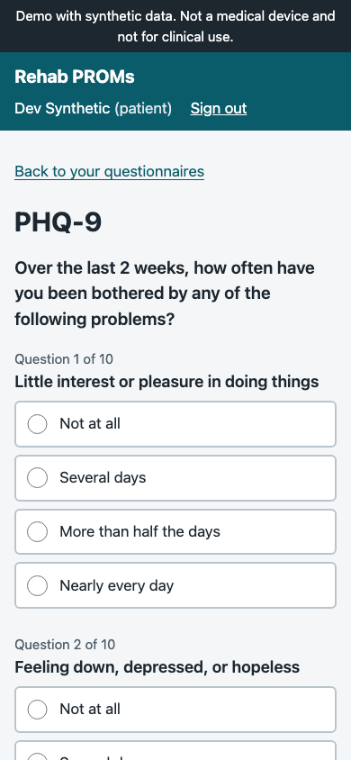
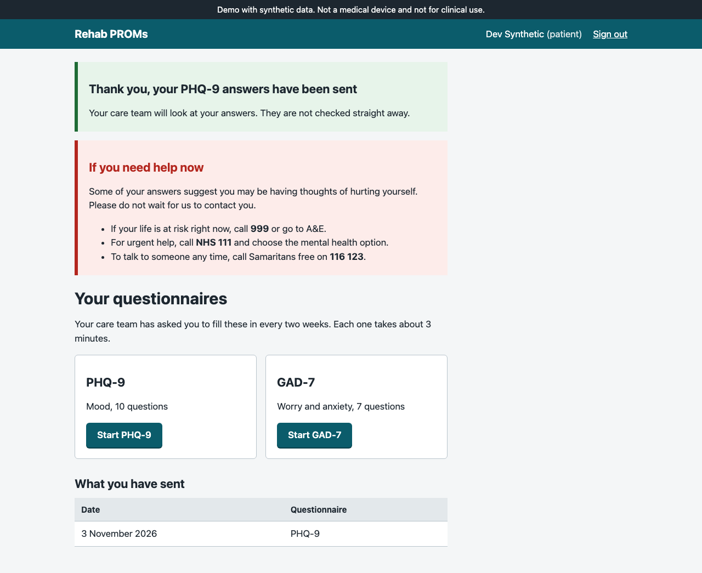
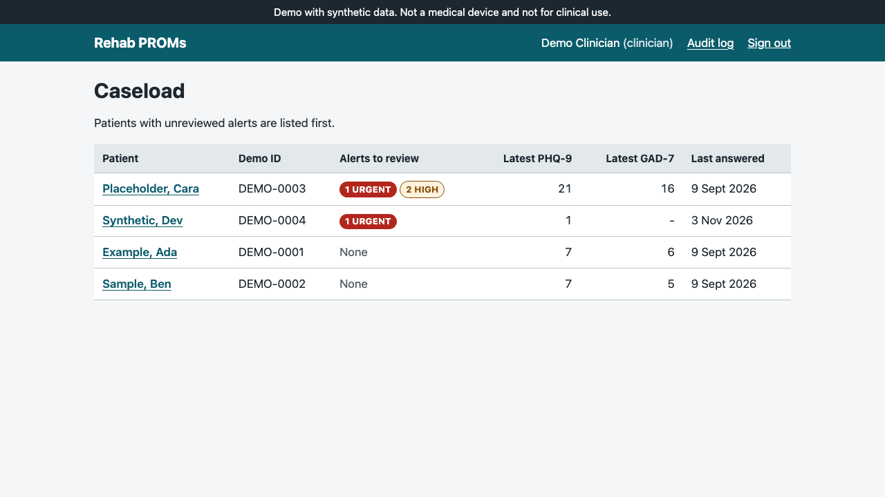
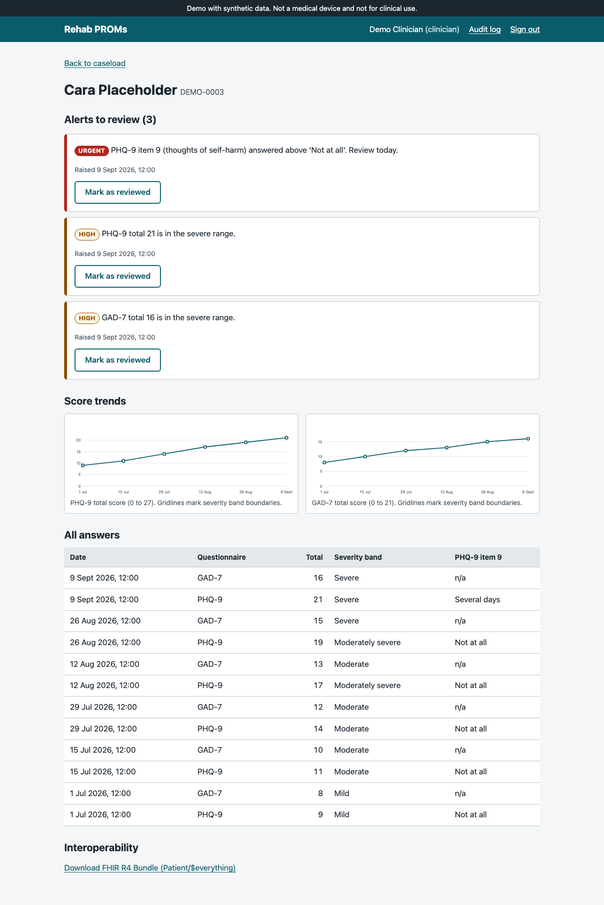
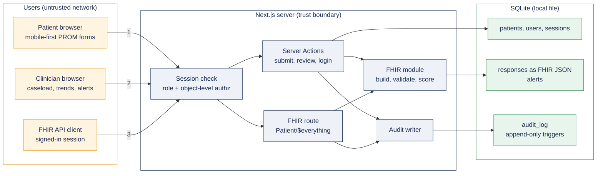

# Rehab PROMs

Remote monitoring of Patient Reported Outcome Measures (PROMs) for a rehabilitation pathway: patients answer PHQ-9 and GAD-7 on their phone, clinicians see score trends and safety alerts, and every record access is audited. Responses are stored as HL7 FHIR R4 `QuestionnaireResponse` resources and can be exported as a FHIR Bundle.

> **Status: portfolio project.** Not a medical device, not clinically validated, not approved or assured by the NHS or any regulator. All people and data in it are synthetic. See [Status and limitations](#status-and-limitations).

| Patient (mobile) | Crisis signposting after a flagged answer |
|---|---|
|  |  |

| Clinician caseload, alerts first | Patient trends, alerts and history |
|---|---|
|  |  |

Screenshots are produced by the Playwright suite itself (`npm run screenshots`), so they always show the real app.

## The problem

Rehabilitation and long-term condition services increasingly ask patients to complete PROMs between appointments. That only helps if three things hold: the questionnaire is easy to complete for people with low digital confidence, a worrying answer reaches a clinician instead of sitting in a database, and the data can leave the system in a standard format. This project is a small, working vertical slice of exactly that.

## Quick start

Requires Node.js 22 or later.

```bash
npm ci
npm run build
npm start          # http://localhost:3000, seeds a synthetic demo database on first run
```

Sign in with `clinician@example.test`, `dev@example.test` (patient with no answers) or `ada@example.test`. The password for every demo account is `demo-password-not-secret`. These accounts exist only in the seeded demo database. `npm run seed` resets it.

## What it does

**Patient side**
- PHQ-9 and GAD-7 rendered directly from the published FHIR `Questionnaire` resources (LOINC 44249-1 and 69737-5), so item text, answer codes and scoring weights come from the instrument definition, not from hand-typed copies.
- Mobile-first, large tap targets, one radio group per question with a proper `fieldset` and `legend`, an error summary that takes focus and links to each unanswered question.
- If PHQ-9 item 9 (thoughts of self-harm) is answered above zero, the confirmation page immediately shows 999, NHS 111 and Samaritans signposting, because nobody is watching the dashboard in real time.
- Patients are not shown their own scores or severity bands (hazard H-07).

**Clinician side**
- Caseload ordered by unreviewed urgent alerts, then high alerts.
- Per-patient trend charts (server-rendered SVG with text alternatives, plus the same data as a table), full answer history including item 9.
- Alerts: `PHQ9_ITEM9` (urgent, independent of total score) and `SEVERE_TOTAL` (PHQ-9 at least 20, GAD-7 at least 15). Reviewing an alert is recorded.
- Audit log page showing who did what, to which record, with what outcome.

**Interoperability**
- `GET /api/fhir/Patient/{id}/$everything` returns a FHIR R4 `searchset` Bundle: the `Patient`, every `QuestionnaireResponse`, and one LOINC-coded total score `Observation` per response (`44261-6`, `70274-6`) with `derivedFrom` back to its response. Content type `application/fhir+json`; errors are `OperationOutcome`.
- Every exported `Patient` carries the `HTEST` meta tag so a receiving system can tell it is test data.
- The companion project [proms-fhir-bridge](https://github.com/BenjisCollector/proms-fhir-bridge) takes this Bundle and pushes it to a FHIR server, and maps NHS Personal Demographics Service records into this app's patient model.

## Architecture



1. Patients submit answers through a Server Action. 2. Clinicians read caseloads and review alerts. 3. The FHIR export is a normal authenticated request; there is no separate unauthenticated API.

| Path | Responsibility |
|---|---|
| `src/questionnaires/` | Vendored FHIR Questionnaires (provenance in [docs/questionnaires.md](docs/questionnaires.md)) |
| `src/lib/fhir/` | Scoring, building and validating `QuestionnaireResponse`, Bundle export. Pure functions, no I/O |
| `src/lib/auth-core.ts` | Password hashing (scrypt), server-side sessions, lockout, object-level authorisation |
| `src/lib/repo.ts` | SQL for responses, alerts and caseload. Submission is one transaction |
| `src/lib/db.ts` | Schema, including CHECK constraints and append-only audit triggers |
| `src/app/` | Pages, Server Actions and the FHIR route |

Key decisions are recorded as ADRs in [docs/adr](docs/adr).

## Testing

| Layer | Tool | What it covers |
|---|---|---|
| Unit | Vitest | Scoring at every severity boundary, item 9 rule, refusal to score partial answers, `QuestionnaireResponse` structural and semantic validation (wrong codes, tampered totals, unknown linkIds) |
| Integration | Vitest + in-memory SQLite | Login and lockout, session expiry, schema constraints, transactional submission with alerts, alert review rules, append-only audit log, FHIR Bundle contents |
| End to end | Playwright | Patient completes PHQ-9 with a flagged answer, sees signposting; clinician sees the alert ranked first, reviews it, finds it in the audit log; access control on pages and the FHIR route |
| Accessibility | axe-core in Playwright | WCAG 2.2 A and AA rules on every page in the journey, including the error state |

```bash
npm run lint && npm run typecheck && npm test && npm run e2e
```

CI runs all of these on every push and pull request ([.github/workflows/ci.yml](.github/workflows/ci.yml)). Automated accessibility checks catch a subset of issues only; see the manual checks listed in [CONTRIBUTING.md](CONTRIBUTING.md).

## Security and governance

- [Threat model (STRIDE)](docs/security/threat-model.md)
- [Data protection note (DPIA-style data flows)](docs/governance/dpia-data-flows.md)
- [Clinical safety hazard log (DCB0129-style)](docs/clinical-safety/hazard-log.md), each hazard linked to the code and test that control it
- [Contributing, code review checklist and PR template](CONTRIBUTING.md): how third-party contributions are assured
- [Security policy](SECURITY.md)

## How AI coding tools were used and checked

This project was built with Claude Code (an AI coding assistant) under my direction. Being specific about what that meant:

- **What the AI did:** drafted most of the first-pass code, tests and documentation from my specification, ran the build and test loop, and produced the screenshots by running the Playwright suite.
- **What I specified:** the scope and stack, the instruments (only freely licensed ones), the item 9 urgent alert, role-based access, auditing of every record access, the FHIR export, and the governance artefacts that had to exist.
- **What the AI proposed:** detailed design choices such as SQLite with raw SQL, server-side sessions, not showing scores to patients, and returning 404 rather than 403 for other patients' records. Each one is written down as an ADR or a hazard-log control so it can be reviewed and challenged, rather than living only in code.
- **How the output was checked:**
  - Tests were written against the published instrument definitions, not against the implementation. One AI-written test was itself wrong (it expected a PHQ-9 total of 27 with item 9 set to zero, which is impossible); the failing test was investigated rather than "fixed" to pass.
  - Clinical logic (scoring, thresholds, item 9) is isolated in small pure functions so a human reviewer can check it line by line against the instrument documentation.
  - Security-relevant behaviour (object-level access, lockout, append-only audit) is tested at the database and HTTP level, not assumed.
  - A dependency the AI first chose (`better-sqlite3` 13) crashed natively on the target Node version; it was caught by running the code, and pinned to 12.
  - CI gates every change with lint, type checks, unit, integration, end-to-end and accessibility tests.
- **What I would require before AI-assisted code reached patients:** the same review checklist as any third-party PR, a named human reviewer for every clinical-logic change, and clinical safety officer sign-off for anything touching the hazard log.

## Status and limitations

- **Portfolio project, not a medical device, not clinically validated.** It has no UKCA marking, no DCB0129 sign-off by a Clinical Safety Officer, no DTAC assessment and no DSPT submission. The governance documents are written in the style of those processes to show how I work; they are not certified evidence.
- Synthetic data only. Names are invented and no NHS numbers are used.
- Alert thresholds are the published severity cut-offs, used as illustrative defaults. A real service must agree them with its clinicians.
- SQLite and a single Node process: fine for a demo, not for a multi-instance deployment (see ADR 0002).
- Single clinical team: every clinician can see every patient. Real deployments need caseload or organisation scoping.
- No MFA, no NHS login or NHS CIS2 integration, no password reset, no consent capture, no data retention jobs, no Content Security Policy yet.
- PHQ-9 and GAD-7 only; licensed instruments (for example EQ-5D) are deliberately not included.

## Licence

Code: MIT, see [LICENSE](LICENSE). The PHQ-9 and GAD-7 instruments are copyright Pfizer Inc. and free to reproduce; the FHIR Questionnaires include LOINC content. See [NOTICE.md](NOTICE.md).
